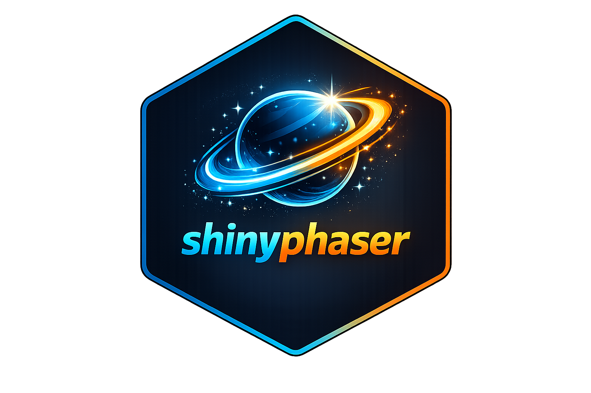
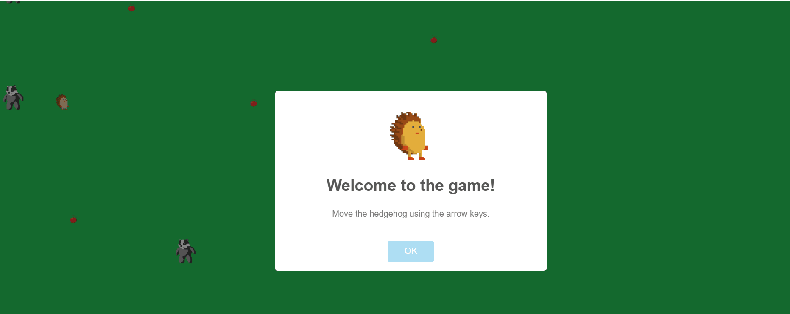

<!-- README.md is generated from README.Rmd. Please edit that file -->

```{r, include = FALSE}
knitr::opts_chunk$set(
  collapse = TRUE,
  comment = "#>"
)
```

# shinyphaser 

<!-- badges: start -->
[](https://github.com/maciekbanas/shinyphaser/actions/workflows/R-CMD-check.yaml)
[](https://CRAN.R-project.org/package=shinyphaser)
[](https://cran.r-project.org/package=shinyphaser)
<!-- badges: end -->

This package provides an R Shiny interface to selected features of the [Phaser 3](https://phaser.io/) game framework.

```{r, echo=FALSE}
knitr::include_graphics("man/figures/geometry_dash_example.gif")
```

## What you can do with shinyphaser

With the current API, you can build small-to-medium 2D game-like interactions in Shiny, including:

- 🎮 creating a game canvas in your Shiny UI,
- 🧩 adding images and animated sprites,
- ⌨️ attaching keyboard-based player controls,
- 💥 defining overlap and collision rules between objects,
- 🔔 reacting to game events from R server logic.

## Installation

Install the stable release from CRAN:

```r
install.packages("shinyphaser")
```

Install the development version from GitHub:

```r
# install.packages("pak")
pak::pak("maciekbanas/shinyphaser")
```

## API scope

`shinyphaser` is intentionally more than a one-to-one translation of the
Phaser API. Alongside wrappers for scene objects and physics operations, it
includes reusable, browser-side behaviours when they remove substantial Shiny
round trips and are useful across game genres. For example,
`Sprite$start_approach_on_sight()` can drive guards, animals, vehicles, or
simulation agents.

Higher-level helpers belong in the package when they:

- operate on generic Phaser concepts rather than an example's story or rules,
- need browser-speed updates that would be inefficient through the Shiny
  server, and
- remain composable with lower-level methods such as `set_in_motion()` and
  `stop_motion()`.

Example-specific quests, combat rules, dialogue, and map progression remain in
example applications. This keeps the core API broadly useful without limiting
it to thin Phaser bindings.

## Learn by example

For a full walkthrough (from static background to movement, animation, overlap, and collision), see [**Build your first shinyphaser game**](https://maciekbanas.github.io/shinyphaser/articles/first-game.html)

For a simple runner with gravity, jumping, and obstacles, see
[**Build a Geometry Dash-style runner**](https://maciekbanas.github.io/shinyphaser/articles/geometry-dash.html).

For tile maps, shoreline selection, and terrain collisions, see
[**Create tile maps for a Shiny game**](https://maciekbanas.github.io/shinyphaser/articles/creating-maps.html).

For enemies that notice and move toward the hero, see
[**Make enemies approach the hero on sight**](https://maciekbanas.github.io/shinyphaser/articles/approach-on-sight.html).

For trees and bushes that hide the hero while blocking movement at their bases,
see [**Walk behind scenery and block its footprint**](https://maciekbanas.github.io/shinyphaser/articles/scenery-and-collision.html).

For the complete list of supported browser expressions and guidance on when to
use ordinary R callbacks, see [**Choose between browser and server actions**](https://maciekbanas.github.io/shinyphaser/articles/browser-server-actions.html).


```{r, echo=FALSE}

```

## Example games created with `shinyphaser`

Three games are included in `inst/examples`, each with its own assets:

- **Hedgehog**: collect apples, avoid enemies, and progress through three levels.
  [Play online](https://maciekbanas.shinyapps.io/hedgehog).
- **Geometry Dash**: jump over spikes in a one-button runner and reach the finish.
- **Swamps RPG**: explore the Mushroom Swamps, fight enemies, and save your game.

With the current development version of shinyphaser installed, run each game
from the repository root:

```r
shiny::runApp("inst/examples/hedgehog")
shiny::runApp("inst/examples/geometry_dash")
shiny::runApp("inst/examples/swamps_rpg")
```
