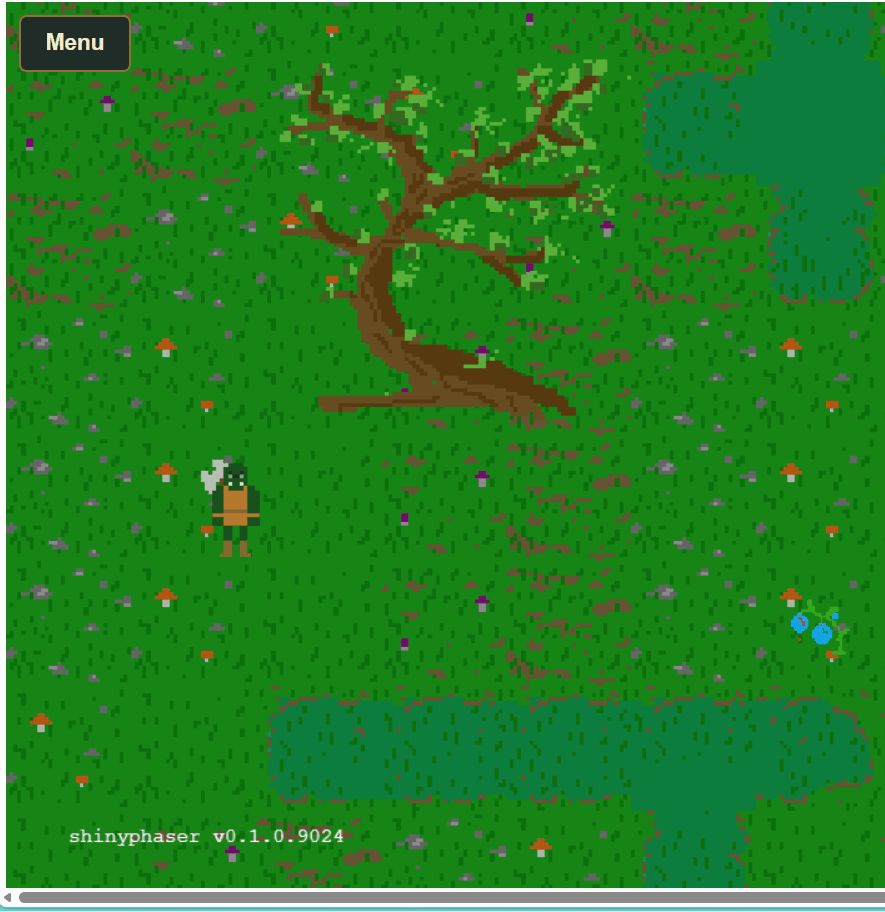

# Walk behind scenery and block its footprint

In a top-down game, a tree has two jobs: its canopy can hide the hero,
while its trunk blocks movement. A bush works the same way. Use separate
objects for appearance and collision so the player can walk behind the
foliage without walking through its base.



| Part | Purpose | shinyphaser API |
|----|----|----|
| Tree or bush image | Draw the whole object, including foliage | `add_image()`, `set_depth()` |
| Invisible footprint | Block a small area on the ground | `add_collision_rectangle()`, `add_collider()` |
| Hero’s feet | Determine where the hero stands | `set_body_size()` |
| Depth ordering | Draw the hero behind or in front as it moves | `set_depth_by_y()` |

The complete implementation lives in `inst/examples/swamps_rpg`. With
the current development version installed, run it from the repository
root:

``` r

shiny::runApp("inst/examples/swamps_rpg")
```

## Draw the image and block only its base

The following snippets use the Swamps RPG resource path registered by
that example. Put the R setup inside its server, after binding `game` to
the session and creating `hero`. For another app, register your own
image directory first.

`tree_1.png` is 200 by 400 pixels. Its image is centered, so placing its
center at `base_y - 200` puts the bottom at `base_y`. The depth uses
that ground position, rather than the center of the tall image.

``` r

base_x <- 600
base_y <- 1000

tree <- game$add_image(
  "tree", "swamps-rpg-assets/terrain/mushroom_swamps/tree_1.png",
  x = base_x, y = base_y - 400 / 2
)
tree$set_depth(base_y)

# A short, narrow rectangle around the trunk's base, not the entire canopy.
game$add_collision_rectangle(
  "tree_footprint", x = base_x, y = base_y - 12,
  width = 64, height = 24
)
game$add_collider("hero", "tree_footprint")
```

The invisible rectangle has a static physics body. The collider prevents
the hero from crossing it from any direction. The image itself has no
physics body: overlapping the canopy is allowed. Use the same pattern
for bushes, with a footprint sized to the part of the bush that touches
the ground.

An object is fully passable if you omit its footprint and collider.
Hiding an image does **not** remove its separate footprint; manage both
objects together when hiding, removing, or switching maps.

## Give the hero a foot-sized collision body

The Orc has 100 by 100 pixel animation frames. Using the entire frame
for collision would prevent the hero from getting close to the foliage.
Set a 32 by 18 pixel body, offset 34 pixels from the frame’s left and 72
from its top:

``` r

hero$set_body_size(width = 32, height = 18, offset_x = 34, offset_y = 72)
```

Sizes and offsets are measured in unscaled frame pixels. Adjust them for
your own artwork. The call is queued if the sprite is still loading.

## Change depth as the hero walks

`set_depth()` sets a fixed drawing depth from R. Larger values draw in
front. The tree stays at `base_y`, but the moving hero needs its depth
refreshed from its ground position. Enable that behavior with:

``` r

hero$set_depth_by_y(offset = 40)
```

The runtime now updates depth to `hero.y + 40` each frame in the
browser. For the centered 100px Orc frame, the frame starts at
`hero.y - 50` and the feet end at pixel 90 within the frame, giving the
40px offset. This value is in world pixels and should match the
artwork’s ground contact point. No custom JavaScript or Shiny position
observer is needed.

When the hero’s feet are above the tree’s base, its depth is smaller, so
the canopy draws over the hero. Below the base, the hero draws in front.
The footprint blocks movement at the trunk independently of drawing
order. This is often called **Y sorting**.

Apply `set_depth_by_y()` to enemies and NPCs too if they should
participate in the same ordering. Repeating the call changes the offset
without installing another update listener. To stop automatic sorting
and keep the last depth:

``` r

hero$set_depth_by_y(enabled = FALSE)
```

Calling `hero$set_depth(20)` also stops sorting and sets a fixed depth.
Listeners are removed when a sprite is destroyed or its scene shuts
down.

Keep screen-fixed text and health bars at a depth above the world, for
example:

``` r

status$set_scroll_factor(0)
status$set_depth(10000)
```

For a 6400-pixel-tall world, 10000 leaves the HUD above all
ground-position depths. The full example applies these R methods to the
hero, enemies, and NPCs, and sets a fixed HUD depth above them.
