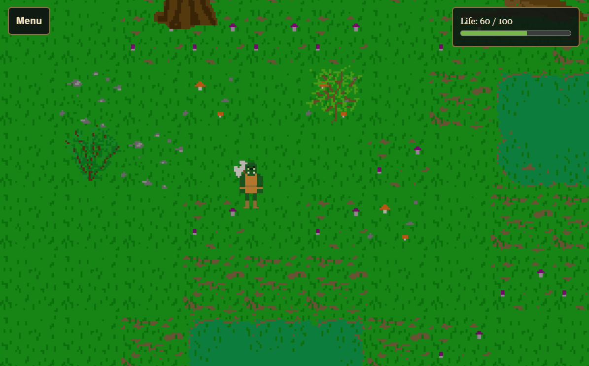

```{r, include=FALSE}
knitr::opts_chunk$set(collapse = TRUE, comment = "#>")
```

An enemy can wander until the hero gets close, display an alert, and then
follow the hero. Compose three independent parts: proximity events detect
entering and leaving range, `Sprite$set_movement()` chooses following or
wandering, and ordinary text actions display feedback. All run in the browser,
without an R timer or custom JavaScript.

This is distance-based detection, not line of sight through walls. The same
movement methods can drive animals, guides, vehicles, or simulation agents;
the same proximity events can reveal a door or transform a tree into a monster.
See [React to proximity](proximity-events.html) for those other reactions.

```{r, echo=FALSE}

```

The compact Swamps RPG uses this behavior for one mushroom enemy. Contact
deals damage; press Space at close range to fight back. See the
[combat article](combat.html) for health, attacks, and defeat. With the current
development version of shinyphaser installed, run the game from the repository
root:

```{r eval=FALSE, purl=FALSE}
shiny::runApp("inst/examples/swamps_rpg")
```

## Create the hero and an enemy

Here is a complete small app using the artwork bundled with Swamps RPG. Save
it as `app.R` in a Shiny app directory. Move with the arrow keys and approach
the mushroom enemy. It displays an alert when it notices the hero.

```{r approach-app, eval=FALSE}
library(shiny)
library(shinyphaser)

addResourcePath("approach-assets", system.file(
  "examples", "swamps_rpg", "www", package = "shinyphaser"
))

game <- PhaserGame$new(width = 960, height = 600)
ui <- tagList(
  tags$p("Move with the arrow keys. Get close to the mushroom, then move away."),
  game$use_phaser()
)

server <- function(input, output, session) {
  game <- PhaserGame$new(width = 960, height = 600)
  game$set_shiny_session(session)
  game$set_world_bounds(960, 600)

  hero <- game$add_sprite(
    "hero", "approach-assets/sprites/hero/orc/hero_orc_idle.png",
    x = 120, y = 300, frame_width = 100, frame_height = 100,
    frame_count = 29, frame_rate = 4
  )
  enemy <- game$add_sprite(
    "mushroom", "approach-assets/sprites/enemies/mushroom_man/mushroom_man_idle.png",
    x = 700, y = 300, frame_width = 100, frame_height = 100,
    frame_count = 8, frame_rate = 8
  )

  for (direction in c("left", "right", "up", "down")) {
    hero$add_animation(
      paste0("move_", direction),
      sprintf("approach-assets/sprites/hero/orc/hero_orc_move_%s.png", direction),
      frame_width = 100, frame_height = 100, frame_count = 6, frame_rate = 8
    )
    enemy$add_animation(
      paste0("move_", direction),
      sprintf("approach-assets/sprites/enemies/mushroom_man/mushroom_man_walk_%s.png", direction),
      frame_width = 100, frame_height = 100, frame_count = 2, frame_rate = 8
    )
  }
  hero$add_player_controls(speed = 220)

  status <- game$add_text("Approach the mushroom", "status", 24, 24)
  status$set_scroll_factor(0)
  status$set_depth(10000)
  game$add_overlap("hero", "mushroom", browser_action = browser_actions({
    status$set("Contact! Move away to escape.")
  }))

  alert <- game$add_text("Enemy noticed you!", "alert", 24, 60, visible = FALSE)
  enemy$set_movement("wander", speed = 100, distance = 60, interval = 1500)
  game$add_proximity_trigger("enemy_enter", "mushroom", target_name = "hero",
    radius = 300, event = "enter", browser_action = browser_actions({
      alert$show()
      enemy$set_movement("follow", target_name = "hero", speed = 100,
                         distance = 60, interval = 100)
    }))
  game$add_proximity_trigger("enemy_leave", "mushroom", target_name = "hero",
    radius = 300, event = "leave", browser_action = browser_actions({
      alert$hide()
      enemy$set_movement("wander", speed = 100, distance = 60, interval = 1500)
    }))
}

shinyApp(ui, server)
```

The target is identified by the **sprite name**, `"hero"`, rather than the R
variable holding it. Give each enemy a unique name if you create several.
Directional animations use the suffixes `move_left`, `move_right`, `move_up`,
and `move_down`. The runtime selects an available movement animation, falling
back to `move` or `idle` when directional animations are absent.

## Configure detection and movement independently

The proximity radius belongs to the triggers; the movement controller has no
range or alert rules. Use the same radius on enter and leave triggers. Give
triggers unique IDs and use `context` in a multi-map game to restrict detection
to the appropriate map.

| Setting | Meaning |
|---|---|
| Trigger `radius` | Distance between object centers that counts as near |
| Movement `mode` | `"follow"`, `"wander"`, or `"stop"` |
| `target_name` | Active scene object to follow; used only in follow mode |
| `speed` | Pixels per second |
| `distance` | Maximum length of each movement step in pixels |
| `interval` | Minimum milliseconds between the starts of movement steps |

Following recomputes the direction towards the target between steps and caps
the step at the remaining distance. Wandering chooses a random cardinal
direction. Neither mode performs pathfinding: colliding terrain can shorten or
prevent a step. Smaller steps adjust direction more frequently.

The controller waits for its sprite to load. Inactive actors and missing or
inactive targets pause movement. Forced animations pause new steps without
cancelling a knockback tween, so the combat module can interrupt pursuit and
let it resume after the reaction.

## Stop, replace, and clean up movement

```{r eval=FALSE}
enemy$stop_motion()          # Interrupt the current step; its controller remains.
enemy$set_movement("stop")   # Stop the controller and current movement.
```

Calling `set_movement()` replaces the actor's previous controller. Destroying
the sprite or shutting down its scene removes the controller. You do not need
an R timer or manual browser interval cleanup.

The alert is independent: use text visibility, sound, or another browser action
on proximity entry and departure. The example shows its message while the hero
is nearby; it does not build alert presentation into movement.

## Keep contact and combat separate

Approaching does not automatically damage the hero or end the game. The small
app above uses `add_overlap()` to show a contact message. In a combat game, a
separate server action can update health, with a throttled sustained overlap:

```{r eval=FALSE}
# Inside your server, after creating the sprites:
life <- reactiveVal(100)
game$add_overlap(
  "hero", "mushroom", input = input,
  mode = "stay", interval = 1000,
  server_action = function(event) {
    life(max(0, life() - 5))
  }
)
```

This subtracts five health at most once per second while the sprites overlap.
Connect `life()` to your own health display. See [Choose between browser and
server actions](browser-server-actions.html) for more on splitting immediate
feedback from R-side game rules.

To combine enemies with trees and bushes, see [Walk behind scenery and block
its footprint](scenery-and-collision.html). `set_depth_by_y()` controls their
drawing order; it does not change detection range or add pathfinding.
