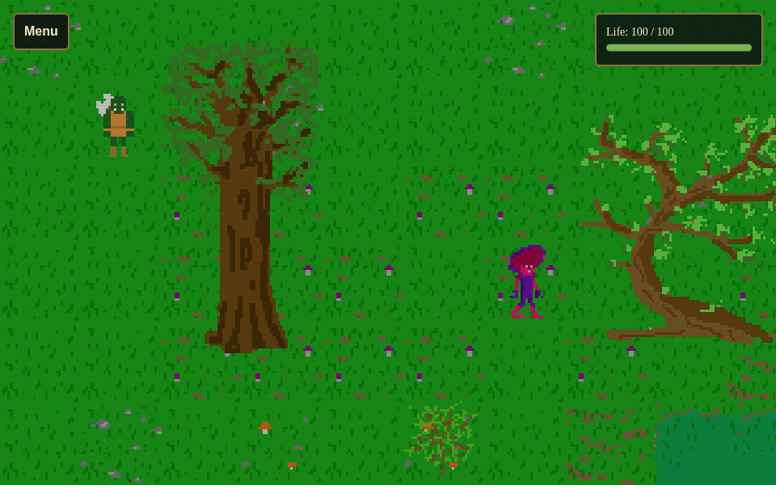

```{r, include=FALSE}
knitr::opts_chunk$set(collapse = TRUE, comment = "#>")
```

Combat combines contact detection, player input, animation, and application
state. Swamps RPG demonstrates a small encounter using the shinyphaser R
interface: a mushroom approaches the hero, contact costs life points, and
Space attacks at close range. No custom JavaScript is needed.

```{r, echo=FALSE}

```

With the current package installed, run this from the repository root:

```{r eval=FALSE}
shiny::runApp("inst/examples/swamps_rpg")
```

Move with the arrow keys and press Space while touching the mushroom. The
hero starts with 100 life points, the mushroom with 6, and each of the four skeletons with 8.
Each successful attack removes 2 enemy life points; contact removes 10
(mushroom) or 12 (skeleton) hero life points, with a shared one-second cooldown.
Three attacks defeat the mushroom and four defeat each skeleton. Fighting is optional:
you can also avoid it while rescuing the spirit and reaching the crypt.

## Keep rules in session-local R state

Create health, range, and cooldown state inside `server`, so visitors do not
share a fight. The example starts with:

```{r eval=FALSE}
life_points <- 100
enemy_max_hit_points <- c(mushroom = 6, skeleton = 8, skeleton_2 = 8,
                          skeleton_3 = 8, skeleton_4 = 8)
enemy_hit_points <- enemy_max_hit_points
enemy_in_range <- stats::setNames(rep(FALSE, length(enemy_max_hit_points)),
                                 names(enemy_max_hit_points))
last_attack <- -Inf
last_damage <- -Inf
enemy_hurt_until <- stats::setNames(rep(-Inf, length(enemy_max_hit_points)),
                                   names(enemy_max_hit_points))
combat_generation <- 0L
```

These are ordinary R values. The callbacks below share their enclosing server
environment and use `<<-` to update that state. A `reactiveVal()` holds a copy
for the Shiny HUD, which displays life points over the map. The HTML HUD stays
fixed while the Phaser camera follows the hero; an in-canvas Text object would
instead need `set_scroll_factor(0)` and a high `set_depth()`.

## Detect contact and limit damage

`add_overlap()` detects overlapping physics bodies. This example deliberately
uses body contact as its melee range, rather than the whole visible axe or
sprite image. The foot-sized bodies are configured with `set_body_size()`.
For a larger attack reach, you would need a separate hitbox or another range
check; enlarging the hero's movement body would also change terrain collision.

Use `mode = "stay"` and `interval = 1000` to receive contact events at most
once per second while bodies overlap. The callback checks the active map,
health, and an R cooldown before subtracting life points. Register
`add_overlap_end()` to clear `enemy_in_range` when the actors separate.

The browser interval limits event traffic. The R cooldown also protects the
rule against rapid re-entry into contact.

## Register attacks and handle defeat

`add_control("Space", input = input, server_action = attack)` calls the R attack
handler. The handler allows one swing every 0.6 seconds, plays the attack
animation and optional sound, and deals damage only when the enemy is in range
and alive. Swinging out of range gives feedback but does not damage the enemy.

Each hit interrupts pursuit, pushes the mushroom away, and plays its damage animation. During
that reaction it cannot deal contact damage. The final hit plays the damage
animation followed by the destruction animation, then hides the mushroom through
`activate_map(..., hidden_objects = "mushroom")`. Map visibility also disables
its physics body and marks it inactive. The health check rejects damage
as soon as life reaches zero, including while the destruction animation plays. Simply hiding artwork would not express all of those
requirements. Delayed animation callbacks check a generation counter so
loading, restarting, or switching maps cannot hide a revived enemy.

When hero life reaches zero, hide and deactivate the hero through the same map
activation mechanism. Ignore further attacks and damage until New game or Load.
The overlaid menu remains available after defeat.

## Apply damage and push the target away

Receiving damage has three separate parts: subtract life points in R, play a
reaction animation, and optionally move the target away from the attacker.
The animation alone does not change health. For example, the contact callback
reduces the hero's life and refreshes the display with:

```{r eval=FALSE}
life_points <<- max(0, life_points - 10)
update_hud()
```

The attack handler does the equivalent for the mushroom:

```{r eval=FALSE}
enemy_hit_points[["mushroom"]] <<- max(0, enemy_hit_points[["mushroom"]] - 2)
```

### Load the damage animations

Before using a reaction, register its spritesheet. The example has a three-frame
reaction for each direction. Here `asset()` is the URL helper defined in
`app.R`; use your own asset URL in another application.

```{r eval=FALSE}
for (direction in c("down", "up", "left", "right")) {
  mushroom$add_animation(paste0("damage_", direction),
    asset(sprintf("sprites/enemies/mushroom_man/mushroom_man_damage_%s.png", direction)),
    frame_width = 100, frame_height = 100, frame_count = 3, frame_rate = 8)
}
# A default reaction is needed when no recent movement direction is available.
mushroom$add_animation("damage",
  asset("sprites/enemies/mushroom_man/mushroom_man_damage_down.png"),
  frame_width = 100, frame_height = 100, frame_count = 3, frame_rate = 8)
```

### Choose a direction away from the attacker

The overlap event contains `x1`, `y1` for the hero and `x2`, `y2` for the
mushroom, because they were registered in that order. Subtract the hero's
position from the mushroom's position and choose the dominant axis:

```{r eval=FALSE}
knockback_from_contact <- function(event) {
  delta <- c(event$x2 - event$x1, event$y2 - event$y1)
  if (length(delta) != 2L || any(!is.finite(delta)) || all(delta == 0)) {
    return(c(x = 0, y = 1))
  }
  if (abs(delta[1]) >= abs(delta[2])) c(x = sign(delta[1]), y = 0) else
    c(x = 0, y = sign(delta[2]))
}
```

Each contact callback stores this vector in `knockback_direction[[id]]` before its
damage-cooldown check. An attack uses the latest reported contact direction.
If the positions coincide or are unavailable, the example pushes downwards.
Using one axis gives the integer directions accepted by `set_in_motion()`.

### Combine knockback and the reaction

The full game keeps an `enemies` list of Sprite objects. Inside the successful-hit
branch, `id` identifies the selected enemy. Cancel its pursuit before the push:

```{r eval=FALSE}
actor <- enemies[[id]]
direction <- knockback_direction[[id]]
actor$stop_motion()
enemy_hurt_until[[id]] <<- now + 0.5
actor$set_in_motion(
  dir_x = direction[["x"]], dir_y = direction[["y"]],
  speed = 130, distance = 52, lag = 0
)
actor$play_animation(paste0(id, "_damage"), duration = 500)
update_hud()
```

`lag = 0` starts the push immediately instead of using the method's default
delay. In clear terrain, 52 pixels at 130 pixels per second takes 0.4 seconds.
Colliding terrain can shorten the displacement. The 0.5-second reaction keeps
pursuit paused and contact damage disabled while the mushroom recoils. Its
damage animation remains visible while it moves, rather than switching to a
walking animation. Move closer again before the next attack if the push
separates the bodies.

On the final hit, the same push and reaction precede the destruction animation.
The delayed destruction and hiding callbacks are cancelled by map transitions,
loading, and restarting. You can use the same `stop_motion()`, `set_in_motion()`,
and `play_animation()` combination for another Sprite, including a hero, after
registering suitable damage artwork and adding its health and cooldown checks.

## Handle more than one enemy

The game registers separate overlap and overlap-end callbacks for each enemy.
Health, contact range, reaction cooldown, and push direction are stored by name.
A swing selects one living enemy in range; if several touch the hero, stable list
order selects the mushroom first. The hero's damage cooldown is shared, so several
enemies cannot apply damage at the same instant.

The skeleton sheets contain ten idle frames and two frames for movement,
attacks, and damage. Only left/right attack and movement artwork is available;
generic right-facing animations provide the fallback for vertical movement.
There is no skeleton destruction sheet. It shows its hit reaction and then
hides, whereas the mushroom plays its destruction animation. All enemies stop dealing
damage immediately at zero health. Save/load and restart manage all five enemies.

## Read the example's combat module

The following is the actual `modules/combat.R` shipped with the game. It runs
inside the server after creating `game`, `hero`, the `enemies` list, and `attack_sound`.
`app.R` provides `show_dialog()` and `notice()`; navigation provides
`show_realm()`. These exist by the time a player event is processed. The HUD
shows only the hero's life points and bar; enemy reactions are shown through
animations. Critical messages, such as game over, use dialogs.

```{r combat-source, echo=FALSE, results='asis'}
combat_file <- system.file("examples", "swamps_rpg", "modules", "combat.R",
                           package = "shinyphaser")
cat("```r\n", paste(readLines(combat_file), collapse = "\n"), "\n```\n", sep = "")
```

This implementation handles combat events in R, so animation commands arrive
after a Shiny round trip. For immediate local visual feedback, the package also
supports `browser_action = browser_actions(...)`; see
[Choose between browser and server actions](browser-server-actions.html).
Keep R health updates separate from cosmetic feedback so an attack cannot
subtract health twice.

## Save and reset the whole encounter

Saving only sprite positions would lose combat progress. The example includes
health in the application state and captures the hero and all enemies:

```{r eval=FALSE}
game$save_game("progress", state = list(
  realm = realm, spirit_rescued = spirit_rescued, completed = completed,
  life_points = life_points, enemy_hit_points = as.list(enemy_hit_points)
), objects = c("hero", names(enemies)), directory = save_directory)
```

Load restores health, updates the HUD, and reapplies map visibility so a
defeated enemy stays inactive. Clear the contact flag when switching maps and
reset cooldowns when loading or restarting; old contact state must not damage an enemy in a
different area. New game restores the hero and all enemies, their health values, and the spirit.
The example's save directory is private to its Shiny session and is deleted
when that session ends.

Enemy detection and pursuit are separate from these combat rules. Read
[Make enemies approach the hero on sight](approach-on-sight.html) to configure
how the encounter begins, and
[Walk behind scenery and block its footprint](scenery-and-collision.html) for
the surrounding trees and bushes.
