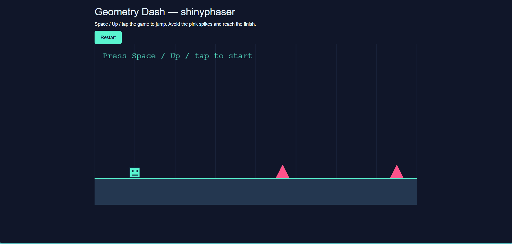

```{r, include=FALSE}
knitr::opts_chunk$set(collapse = TRUE, comment = "#>")
```

A Geometry Dash-style game needs just a few rules: a cube moves forward,
the player jumps over obstacles, and touching an obstacle ends the run.
This walkthrough builds a small version with **shinyphaser**. Jumping and
collision reactions run in the browser, without waiting for an R round trip.

Use the current development version of shinyphaser. The complete example,
including its artwork, lives in `inst/examples/geometry_dash`. From the
repository root, launch it with:

```{r eval=FALSE, purl=FALSE}
shiny::runApp("inst/examples/geometry_dash")
```

## Create the scene

The following is a complete, smaller app. It reuses the cube and spike images
bundled with the installed package. Save the code as `app.R` in a Shiny app
directory. The explicit resource path makes the images available over HTTP.

`gravity_y` pulls the cube down. A visible floor supplies the artwork, while an
invisible collision rectangle supplies the static physics body. The sprite is
32 by 32 pixels, matching the cube image.

```{r runner-app, eval=FALSE}
library(shiny)
library(shinyphaser)

addResourcePath("dash-assets", system.file(
  "examples", "geometry_dash", "www", package = "shinyphaser"
))

game <- PhaserGame$new(width = 960, height = 480, gravity_y = 1400)
ui <- tagList(
  tags$p("Space to start and jump. Avoid the spikes and reach the green line."),
  tags$button(type = "button", onclick = "window.location.reload()", "Restart"),
  game$use_phaser()
)

server <- function(input, output, session) {
  game <- PhaserGame$new(width = 960, height = 480, gravity_y = 1400)
  game$set_shiny_session(session)
  game$set_world_bounds(1800, 480)

  alive <- game$add_state("alive", TRUE)
  grounded <- game$add_state("grounded", FALSE)

  game$add_rectangle("floor_art", 900, 440, 1800, 80, "0x243750")
  game$add_collision_rectangle("floor", 900, 440, 1800, 80)
  player <- game$add_sprite("cube", "dash-assets/cube.png", 120, 384,
                             frame_width = 32, frame_height = 32)
  player$follow_camera()

  status <- game$add_text("Press Space to start", "status", 24, 24)
  status$set_scroll_factor(0)
  status$set_depth(20)

  game$add_collider("cube", "floor", browser_action = browser_actions({
    grounded$set(TRUE)
  }))

  game$add_control("Space", browser_action = browser_actions({
    if (alive$is_true() && grounded$is_true()) {
      grounded$set(FALSE)
      player$set_velocity_x(260)
      player$set_velocity_y(-480)
      status$set("Keep jumping!")
    }
  }))

  for (x in c(560, 900, 1240)) {
    name <- paste0("spike_", x)
    game$add_image(paste0(name, "_art"), "dash-assets/spike.png", x, 380)
    game$add_collision_rectangle(name, x, 385, 20, 30)
    game$add_overlap("cube", name, browser_action = browser_actions({
      if (alive$is_true()) {
        alive$set(FALSE)
        player$stop_motion()
        status$set("Crashed! Click Restart.")
      }
    }))
  }

  game$add_rectangle("finish_art", 1600, 300, 8, 200, "0x59f5d0")
  game$add_collision_rectangle("finish", 1600, 300, 8, 200)
  game$add_overlap("cube", "finish", browser_action = browser_actions({
    if (alive$is_true()) {
      alive$set(FALSE)
      player$stop_motion()
      status$set("Level complete! Click Restart.")
    }
  }))
}

shinyApp(ui, server)
```

## Jump only after landing

The floor collider sets browser state `grounded` to `TRUE` whenever the cube
lands. Space checks both `alive` and `grounded`, clears the grounded flag, and
sets the cube's velocity. Positive horizontal velocity starts the automatic
run; negative vertical velocity launches the jump. Gravity brings the cube
back to the floor. Clearing the flag prevents another jump while airborne.

Calls such as `grounded$is_true()` and `grounded$set()` are browser-action
expressions: use them inside `browser_actions()`, rather than executing them
as ordinary R methods. See [Choose between browser and server
actions](browser-server-actions.html) for more details.

## Stop on obstacles and finish the level

Each spike has separate artwork and an inset rectangular hitbox. An overlap
with the hitbox sets `alive` to `FALSE`, stops movement, and updates the text.
The finish line uses the same pattern with a success message. The alive flag
also prevents further jumps after either outcome.

`follow_camera()` keeps the player in view as the course scrolls.
`set_scroll_factor(0)` fixes the status text to the screen, and `set_depth(20)`
draws it above the game objects. Restart reloads the page and creates fresh
session state.

## Tune the course

- Increase horizontal velocity to make obstacles approach faster.
- Make vertical velocity more negative for a higher jump.
- Increase `gravity_y` for a shorter, sharper jump.
- Adjust spike positions, keeping enough space to land between jumps.

The full example adds a longer course, Up-arrow and tap controls, and styling.
Its images stay in the game's own `www/` directory. Phaser itself is loaded
from jsDelivr, so the browser needs Internet access.

## See it in action

```{r, echo=FALSE, out.width="100%", fig.alt="Geometry Dash example with a cube jumping over spikes"}

```
